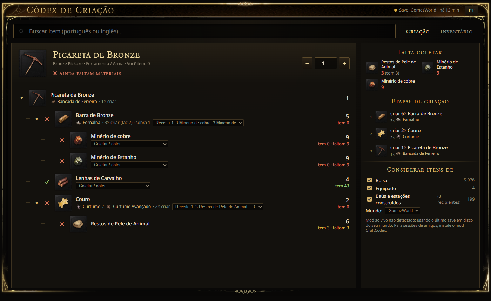

# Códex de Criação — RuneScape: Dragonwilds

Overlay para **RuneScape: Dragonwilds** que mostra a **árvore completa de criação** de qualquer item do jogo, com quantidades, estações e **o que você já tem ou ainda falta**, lendo o seu inventário e os baús **da sessão em que você está jogando** (inclusive no mundo de um amigo).

**🌐 Site e demo interativa: https://dvgomez.github.io/dragonwilds-crafting-codex/**

**⬇ Download: [Codex-de-Criacao.zip](https://github.com/dvGomez/dragonwilds-crafting-codex/releases/latest/download/Codex-de-Criacao.zip)** ([todas as versões](https://github.com/dvGomez/dragonwilds-crafting-codex/releases))



> *English: in-game overlay for RuneScape: Dragonwilds. Search any item (EN or PT-BR) and get the full crafting tree, with quantities, stations, and what you already have or are still missing, based on your live session inventory and chests. Windows only. Install: run `Instalar.cmd`.*

## Recursos

- 🔎 **Busca em português ou inglês** em todos os itens do jogo (~2.300 itens, ~1.900 receitas, incluindo peças de construção).
- 🌳 **Árvore inteira de criação**: quantidades, quantas vezes criar, sobras e em qual estação (Fornalha, Bancada de Ferreiro…).
- 🎒 **O que você tem e o que falta**, somando bolsa, equipamento e baús/estações construídos.
- 📋 **Lista de compras** ("Falta coletar") e **etapas de criação na ordem certa**.
- 🔁 Troca de receita quando há alternativas, ou "coletar em vez de criar".
- 🔒 Marca as receitas que o seu personagem ainda não aprendeu.
- 🎮 **Overlay dentro do jogo** com `F8`, no visual do próprio jogo (fontes e molduras extraídas da sua instalação).
- 📡 **Sessão ao vivo** via mod (opcional): funciona no seu mundo e no de amigos, inclusive crossplay.

## Requisitos

- Windows 10/11 com **RuneScape: Dragonwilds** instalado pela Steam.
- [**Node.js 20+**](https://nodejs.org) (o instalador oferece instalar via `winget` se faltar).
- Internet na instalação (baixa o .NET 10 SDK localmente na pasta do projeto, o Electron e, se você quiser, o UE4SS).

## Instalação

1. Baixe o **[Codex-de-Criacao.zip](https://github.com/dvGomez/dragonwilds-crafting-codex/releases/latest/download/Codex-de-Criacao.zip)** da última versão e extraia em qualquer pasta (ou use `git clone`).
2. Dê dois cliques em **`Instalar.cmd`**. Ele:
   - encontra o jogo automaticamente nas bibliotecas da Steam (ou pergunta a pasta);
   - extrai itens, receitas, textos PT/EN e ícones **do seu jogo instalado** (1 a 3 minutos);
   - instala o app;
   - pergunta se você quer o **mod ao vivo** (recomendado, veja abaixo);
   - cria o atalho **Códex de Criação** na Área de Trabalho.

> Nenhum arquivo do jogo vem neste repositório: tudo é gerado localmente a partir da sua cópia.

## Como usar

1. Abra o **Códex de Criação** (atalho na Área de Trabalho ou `Iniciar Codex.vbs`). Ele fica na bandeja do Windows.
2. No jogo, aperte **`F8`** para abrir ou fechar. `Esc` também fecha.
3. Digite o item (ex.: `picareta de bronze` ou `bronze pickaxe`) e escolha na lista.
4. Ajuste a **quantidade** no canto superior direito.
5. Em **Considerar itens de**, escolha o que conta como "já tenho" (bolsa, equipado, baús construídos, baús do mundo).
6. A aba **Inventário** mostra tudo o que o app está lendo, separado por baú.

Dicas:
- Clique no nome de qualquer ingrediente para abrir a árvore dele.
- O seletor em cada linha troca a receita ou marca "Coletar / obter" (não criar).
- Também funciona no navegador ou no navegador do overlay da Steam (`Shift+Tab`): `http://127.0.0.1:7777`. Dá para abrir direto um item com `?item=Bronze Pickaxe`.

## Mod ao vivo (UE4SS + CraftCodex)

Sem o mod, o app usa o **último save do seu mundo** no disco: não vê o mundo de amigos e só atualiza quando o jogo salva.
Com o mod, ele lê a **sessão atual** a cada ~2 segundos.

- O mod **só lê** inventários e grava um arquivo no seu PC (`%LOCALAPPDATA%\RSDragonwilds\Saved\CraftCodex\live.json`). Não altera itens e não envia nada pela rede.
- Usa o [UE4SS](https://github.com/UE4SS-RE/RE-UE4SS) oficial (build *experimental-latest*, necessária para Unreal 5.6). O instalador confere o SHA-256 do download e desliga os mods padrão do UE4SS (console/cheats); só o CraftCodex fica ativo.
- **`Desativar mod.cmd`** deixa o jogo 100% original. **`Ativar mod.cmd`** liga de novo. Feche o jogo antes de usar os dois.
- Baús de outros jogadores só aparecem se estiverem carregados na sua sessão (perto de você).

> ⚠️ Mods não são oficiais. Hoje o jogo roda sem anti-cheat e o UE4SS funciona em multiplayer, mas uma atualização do jogo pode mudar isso. Se o jogo não abrir depois de um patch, use `Desativar mod.cmd`.

## Depois de uma atualização do jogo

Rode **`Instalar.cmd`** de novo para extrair os dados atualizados.

## Solução de problemas

| Problema | Solução |
|---|---|
| `F8` não abre por cima do jogo | Use o modo de vídeo **Janela sem bordas / Tela cheia em janela** no jogo. O modo tela cheia exclusiva não permite overlays. |
| Quero outra tecla | Edite `hotkey` em `%APPDATA%\dragonwilds-crafting-codex\config.json` (ex.: `"F9"`, `"Alt+C"`) e reabra o Códex. |
| "Mod ao vivo não detectado" | Verifique se o mod está ativado (`Ativar mod.cmd`) e se você está dentro de um mundo. O log do UE4SS fica em `...\RSDragonwilds\Binaries\Win64\ue4ss\UE4SS.log`. |
| Fechei o Códex e o F8 parou | O botão ✕ só esconde. Para sair de vez, use o ícone na bandeja; para voltar, abra o atalho. |

## Desinstalar

1. Feche o jogo e rode `Desativar mod.cmd` (ou apague `dwmapi.dll` e a pasta `ue4ss` em `RSDragonwilds\Binaries\Win64`).
2. Apague a pasta do projeto e o atalho da Área de Trabalho.

## Como funciona (para desenvolvedores)

```
extractor/   C# + CUE4Parse: lê os .utoc/.ucas do jogo (itens, receitas, estações, locres PT/EN, ícones)
tools/       build_db.js: gera app/data/db.json a partir da extração; build_demo.js: gera a demo web (docs/demo)
docs/        site do GitHub Pages (página + demo com dados de exemplo, sem arte do jogo)
app/         Electron + servidor local (src/) e interface (ui/)
mod/         CraftCodex (Lua/UE4SS): main.lua recarrega core.lua sozinho quando ele muda
scripts/     instalador e liga/desliga do mod (PowerShell)
```

- Os itens são identificados pelo `PersistenceID` (saves) ou pelo caminho do asset (mod ao vivo).
- O mapeamento de classes (`.usmap`) vem do [RSDWArchive](https://github.com/RSDWArchive/RSDWArchive). Classes que mudaram desde então são lidas direto dos bytes do asset.

## Créditos

[CUE4Parse](https://github.com/FabianFG/CUE4Parse) · [UE4SS](https://github.com/UE4SS-RE/RE-UE4SS) · [RSDWArchive](https://github.com/RSDWArchive/RSDWArchive) (usmap) · [BCnEncoder.NET](https://github.com/Nominom/BCnEncoder.NET) · [Electron](https://www.electronjs.org)

## Aviso legal

Projeto de fã, **não oficial** e sem vínculo com a Jagex. *RuneScape* e *RuneScape: Dragonwilds* são marcas da Jagex Ltd. Este repositório não distribui nenhum arquivo do jogo: ícones, textos, fontes e texturas são extraídos localmente da cópia instalada de cada usuário. Use por sua conta e risco.

Código sob licença [MIT](LICENSE).
